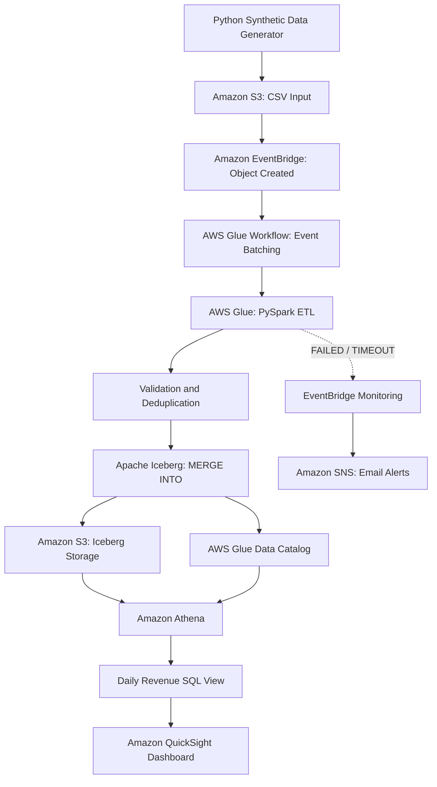

# Architecture and Data Flow

This project implements an event-driven incremental data pipeline on AWS.

## Pipeline Components

| Component | Responsibility |
|---|---|
| Amazon S3 | Stores incoming CSV batches and Iceberg data |
| Amazon EventBridge | Routes S3 creation events and Glue failure events |
| AWS Glue Workflow | Coordinates event-triggered processing |
| AWS Glue PySpark | Validates input and performs incremental UPSERT |
| Apache Iceberg | Provides transactional updates and snapshots |
| AWS Glue Data Catalog | Stores table metadata |
| Amazon Athena | Provides analytical SQL queries |
| Amazon QuickSight | Visualizes daily and cumulative revenue |
| Amazon SNS | Sends job failure notifications |

## Incremental Processing

The workflow uses event batching (3 events, 120-second window). The Glue job uses bookmarks to identify new input files and Iceberg MERGE operations to insert or update order records.

## Scope

This architecture was validated using synthetic data and is not presented as a production-scale deployment.